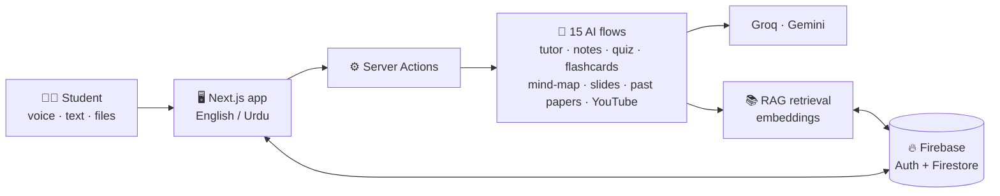

<!-- Taleem AI · README by Usama Shahid (fewgets) -->
<div align="center">


<p>
  
  
  
  
  
  
</p>

<p>
  <a href="#-features"><b>Features</b></a> · <a href="#-educational-games"><b>Educational Games</b></a> · <a href="#-gallery"><b>Gallery</b></a> · <a href="#-run-locally"><b>Run Locally</b></a>
</p>

</div>

---
<p align="center">
  
</p>

## 🔭 Overview

Taleem AI is a comprehensive AI-powered learning platform designed specifically for **Pakistani students**. It bridges the gap between rote memorisation and genuine conceptual understanding through cutting-edge artificial intelligence, tailored to Pakistan's education system, syllabus, and linguistic needs.

The platform features a **voice-first bilingual interface** (English and Urdu), a **curriculum-grounded RAG system** that answers questions strictly from official textbooks, a complete **smart study suite**, a full **gamification engine** with six educational games, and a **personalised dashboard** for tracking progress.

<p align="center">
  
  
</p>


---

## ✨ Features

### 🎙️ Voice-First Bilingual Interface

Students interact naturally by speaking in English or Urdu. The platform supports full voice-based Q&A, navigation, and content generation, making advanced technology accessible to users of all technical backgrounds. Voice recognition and synthesis work seamlessly across both languages, allowing students to ask questions, request notes, or navigate the platform entirely hands-free.

<p align="center">
  
  
</p>

### 📚 Curriculum-Grounded RAG Tutoring

Unlike generic AI tools, Taleem AI knowledge base is built exclusively from official Pakistani curriculum textbooks, board papers, and user-uploaded materials. The retrieval-augmented generation system ensures answers are accurate, contextually relevant, and strictly grounded in provided sources, eliminating hallucination and off-topic responses.

<p align="center">
  
  
</p>

### 🧠 Smart Study Suite

Upload any academic document and instantly generate study materials across multiple formats:

- **AI Notes** with concept maps, diagrams, and key takeaways
- **Interactive Quizzes** with real-time scoring and performance analytics
- **Smart Flashcards** with swipe-based review and spaced repetition
- **Professional Presentations** with slide-by-slide generation and formatting
- **Past Paper Analysis** identifying recurring exam question patterns, topic weightage, and frequently tested concepts

<p align="center">
  
  
  
</p>

### 🏆 Gamified Learning Experience

A complete gamification system designed to maintain student motivation and make studying enjoyable:

| Feature | Description |
|---|---|
| Leveling System | Progress from Beginner through Scholar to Ustaad |
| Achievement Badges | Unlock milestones for streaks, quiz scores, and content creation |
| Daily Streaks | Consecutive study day tracking with rewards |
| Points System | Earn points for completing activities, quizzes, and study sessions |
| Leaderboards | Subject-specific and overall rankings for friendly competition |

<p align="center">
  
  
</p>

### 📊 Personalised Dashboard

A motivational command centre that gives students complete visibility into their learning journey, including current level, XP, points, streak count, subject-wise performance breakdown with visual charts, quiz accuracy trends, achievement badges, and personalised study recommendations.

<p align="center">
  
  
</p>

### ▶️ YouTube Video Summariser

Paste any educational video link and receive a concise, structured summary of key concepts. This feature saves hours of lecture review time by extracting the most important points, organising them into digestible sections, and presenting them alongside timestamps for quick reference.

<p align="center">
  
  
</p>

### 📝 AI Notes Generator

Generate beautifully formatted, decorated study notes from any PDF or text input. The system automatically creates concept maps, extracts key terminology with definitions, and offers downloadable formats for offline study.

<p align="center">
  
  
</p>

### 🤖 RAG-Based AI Tutor (Text and Voice Mode)

A conversational AI tutor available in both text-based chat and voice-based conversation modes. The tutor answers questions strictly within provided documents with no outside knowledge leakage, ensuring students receive accurate, curriculum-aligned responses every time.

<p align="center">
  
  
</p>

---

## 🎮 Educational Games

Six interactive games that reinforce learning through play. Each game targets different cognitive skills and subject areas:

| Game | Focus | Description |
|---|---|---|
| 🗺️ Map Master Pakistan | Geography | Map-based challenges covering physical and political geography |
| ⚡ Subject Sprint | General Knowledge | Fast-paced quiz game across all academic subjects |
| 📖 Vocabulary Voyage | Language Learning | Vocabulary building through contextual word challenges |
| ⏳ Timeline Tangle | History | Historical event sequencing and chronological ordering |
| ✍️ Urdu Haroof Hero | Urdu Literacy | Urdu language grammar, vocabulary, and comprehension |
| 🔬 Science Detective | Scientific Reasoning | Experiment-based puzzles and scientific inquiry challenges |

<p align="center">
  
  
  
</p>
<p align="center">
  
  
  
</p>

---

## 📸 Gallery

<div align="center">
  
</div>

---

---

## 🧰 Tech Stack

| Layer | Technology |
|---|---|
| Framework | **Next.js 15** (App Router, Server Actions), React 18, TypeScript |
| Styling and UI | Tailwind CSS, shadcn/ui (Radix UI), Framer Motion, Lucide |
| AI / LLM | **Groq** (`llama-3.3-70b-versatile`), Google **Genkit** with **Gemini 2.5 Flash** |
| Retrieval | Embeddings + RAG over uploaded documents |
| Auth and Data | **Firebase** Authentication (Google + email), Firestore, Firebase Admin |
| Visuals and Export | Mermaid (mind maps), Recharts, PptxGenJS (presentations) |
| Media | YouTube transcript extraction, Web Speech (voice in and out) |
| Deployment | Vercel |

---

## 🏗️ Architecture



---

## 🚀 Run Locally

**Prerequisites:** Node.js 18+, a [Groq API key](https://console.groq.com/keys) and (optionally) a Firebase project.

```bash
git clone https://github.com/fewgets/Taleem-AI.git
cd Taleem-AI
npm install
```

Create `.env.local` from the template:

```bash
cp .env.example .env.local
```

| Variable | Required | Purpose |
|---|:-:|---|
| `GROQ_API_KEY` | ✅ | Powers the tutor, quizzes, notes, flashcards and more |
| `GOOGLE_GENAI_API_KEY` | ➖ | Gemini via Genkit |
| `FIREBASE_SERVICE_ACCOUNT_KEY` | ➖ | Server-side Firestore (document uploads, daily challenges) |
| `NEXT_PUBLIC_FIREBASE_*` | ➖ | Firebase web config for login and data |

```bash
npm run dev      # http://localhost:3000
```

Other scripts: `npm run build` · `npm start` · `npm run typecheck` · `npm run lint`

---

## 📁 Project Structure

```text
src/
├── app/
│   ├── (dashboard)/        # ai-tutor · voice-tutor · study-suite · quiz · flashcards · notes
│   │                       # mind-map · presentation-maker · past-papers · youtube-summarizer · games
│   ├── parent/             # Parent login and dashboard
│   └── login · signup · about · docs
├── components/features/    # Feature UIs (tutor, quiz, flashcards, gamification…)
├── server/
│   ├── actions.ts          # Server actions
│   └── ai/flows/           # 15 AI flows (Groq + Genkit)
├── firebase/               # Client SDK, hooks, providers
└── lib/                    # Translations (EN/UR), gamification, maps, types
```

---

## 🤝 Let's Work Together

<div align="center">

**Have an idea, a freelance project, or want to collaborate on something in AI?**
I'm always open to collaborations, freelance work and full-time opportunities.

<a href="mailto:shaikhusama541@gmail.com?subject=Collaboration%20-%20Taleem%20AI">
  
</a>
<a href="https://www.linkedin.com/in/-usamashahid/">
  
</a>
<a href="https://github.com/fewgets">
  
</a>

<br/><br/>

⭐ **If you like this project, please give it a star. It really helps!** ⭐

<br/>

<h3>"Education is the most powerful tool we can use to change the world."</h3>


</div>
